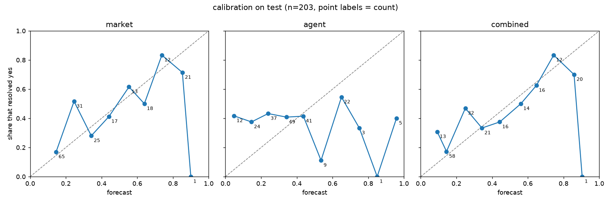
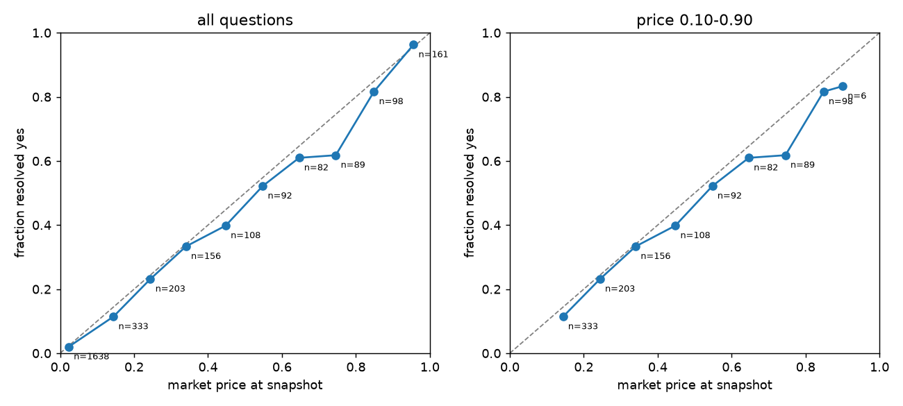

# oracle: can a small local ai out-forecast polymarket?

I wanted to know whether a language model that reads the news can predict real-world events better than a prediction market. So I took real Polymarket questions that opened after the model's training data ends, gave a model running on my laptop only the news published before each forecast, and scored it against the market price at the same moment. I also checked whether blending the model with the market beats the market alone.

The short version: the market wins clearly, and adding the model to the market doesn't help. That's a null result, and I think it's an honest one. The rest of this page is how I got there and how sure I am.

Everything here ran for $0: free public APIs, free news, and an open model on my own laptop.

## the result

<!-- auto:headline -->
| forecaster | brier | log loss | brier minus market | 95% ci |
|---|---|---|---|---|
| market price | 0.216 | 0.628 |  |  |
| combined (market + agent) | 0.217 | 0.633 | +0.0011 | -0.0006 to +0.0030 |
| market, recalibrated on train | 0.218 | 0.634 | +0.0017 | -0.0000 to +0.0034 |
| 50/50 average of market and agent | 0.234 | 0.665 | +0.0179 | -0.0022 to +0.0385 |
| always the train yes rate | 0.242 | 0.677 | +0.0261 | -0.0053 to +0.0564 |
| agent, recalibrated on train | 0.247 | 0.687 | +0.0307 | -0.0005 to +0.0610 |
| always 50% | 0.250 | 0.693 | +0.0340 | +0.0008 to +0.0648 |
| agent (gemma 3 12b, picked headlines) | 0.281 | 0.807 | +0.0655 | +0.0272 to +0.1041 |

test set: 203 questions from 189 events, 41% resolved yes. 1 more got no usable answer from the agent and are left out. lower is better for both scores. cis resample whole events 10,000 times.

**combined minus recalibrated market: -0.0005 (95% ci -0.0012 to +0.0002).**
<!-- /auto -->

"Recalibrated" means refit with a logistic regression on the training questions. That last bolded line is the real test of "does the agent add anything". A fitted model can beat the raw price just by fixing the market's own small calibration errors, so the fair comparison is a combined model against a market-only model that got the same fitting. The confidence interval sits right around zero.



In the calibration plot, a forecaster on the dashed line is perfectly calibrated: its 30% forecasts happen 30% of the time. The agent's forecasts bunch up in the middle. Mostly it just can't tell a likely question from an unlikely one nearly as well as the market can. The Brier decomposition says the same thing: most of the agent's gap is resolution (separating yes from no). Its reliability is worse too, but that's the smaller part.

<!-- auto:decomposition -->
| forecaster | reliability (lower is better) | resolution (higher is better) | uncertainty | brier |
|---|---|---|---|---|
| market price | 0.020 | 0.047 | 0.242 | 0.216 |
| agent (gemma 3 12b, picked headlines) | 0.045 | 0.007 | 0.242 | 0.281 |
| combined (market + agent) | 0.018 | 0.042 | 0.242 | 0.217 |
<!-- /auto -->

## is the market itself calibrated?

Before comparing anything to the market, I checked whether its prices mean what they say. I took a random sample of 8,000 closed binary Polymarket markets that opened after September 2024 (with at least $1,000 traded over their lifetime), took a weekly snapshot 7 to 35 days before each one's scheduled end, and used the last real trade before that moment as the price (only for markets with at least 5 trades and $100 traded in the week before).

<!-- auto:market -->
| questions | n | events | yes rate | market brier (95% ci) | always the yes rate | calibration slope (95% ci) |
|---|---|---|---|---|---|---|
| full | 2,960 | 2,227 | 20% | 0.084 (0.077 to 0.090) | 0.162 | 0.99 (0.92 to 1.08) |
| band 0.10-0.90 | 1,167 | 1,015 | 36% | 0.181 (0.170 to 0.193) | 0.230 | 0.94 (0.81 to 1.06) |
<!-- /auto -->



A calibration slope of 1 is perfect, and the market sits right there. I expected to see the favorite–longshot bias (long shots priced too high), and on this data I couldn't find it. The second row is the band the agent was tested on, questions the market priced between 10% and 90%. Those are the harder, more uncertain questions, where an agent has the most room to help.

## keeping the model from peeking

The biggest risk in a project like this is leakage: a model that already knows how things turned out will look like a great forecaster. I designed around it in four ways.

1. **Only questions after the training cutoff.** Gemma 3's training data ends in August 2024, and every question here opened after September 2024.
2. **News only from before the forecast.** The agent searches GDELT, a free news index you can query by date, and only sees articles published before the snapshot.
3. **Same-moment comparison.** The agent and the market are scored at the same timestamp, never with a later price.
4. **A leakage probe.** I asked each model outright whether it knew the outcome, both on these questions and on 100 big markets that resolved between January and July 2024, which it could have seen in training.

<!-- auto:probe -->
| model | questions | n | says it knows the outcome | its claimed outcome was right |
|---|---|---|---|---|
| gemma3:12b | after the cutoff (train) | 276 | 9% | 72% of 25 |
| gemma3:12b | before the cutoff (control) | 100 | 56% | 64% of 56 |
| gemma3:4b | after the cutoff (train) | 276 | 100% | 44% of 265 |
| gemma3:4b | before the cutoff (control) | 100 | 100% | 38% of 100 |
<!-- /auto -->

The 12B model claims to know the new questions far less often than the old ones, which is what I'd expect from a model that hasn't seen the answers. When it did claim to know a new one, it mostly said "no", which is also the most common outcome, so its hit rate there isn't much evidence of leakage. The 4B model says it knows everything, old and new, so its answer to that question is meaningless. I report it anyway because it's a good reminder that you can't just ask a model what it knows.

## the agent

The agent is Gemma 3 12B running through Ollama, with temperature 0 and a fixed seed, and every reply is cached so reruns give identical answers. For each question it gets the top 50 GDELT headlines from the 30 days before the snapshot, picks up to 15 that matter, and then writes a short rationale and a probability as JSON, which is validated with pydantic. I named this setup as the main agent before opening the test set. The other setups I tried are reported here as secondary results, also on test:

<!-- auto:arms -->
| agent | n | brier | market brier, same questions | minus market | 95% ci | average forecast |
|---|---|---|---|---|---|---|
| agent (gemma 3 12b, picked headlines) | 203 | 0.281 | 0.216 | +0.065 | +0.027 to +0.104 | 0.37 |
| gemma 3 12b, no news | 204 | 0.293 | 0.216 | +0.077 | +0.034 to +0.121 | 0.29 |
| gemma 3 4b, news | 201 | 0.295 | 0.216 | +0.079 | +0.037 to +0.122 | 0.52 |
| gemma 3 4b, no news | 204 | 0.292 | 0.216 | +0.076 | +0.034 to +0.117 | 0.44 |
<!-- /auto -->

None of them comes close to the market. The news barely helps the 12B, and the 4B does about as badly with news as without.

## how I scored it

I used the Brier score (mean squared error of the probability) and log loss. Accuracy would throw away the thing I care about, which is whether a 70% forecast really means 70%.

I split the questions by time, not at random. Questions come in events (one election can have ten markets), and markets in the same event move together. A random split would put siblings from the same event on both sides, so the combination model would be tested on events it was fit on. The yes rate also drifts over time, and a time split shows whether a model fit on the past still works on the future, which is how a forecaster actually gets used.

<!-- auto:split -->
the news sample has 500 questions: 276 in train (of which 40 were a dev set for tuning prompts), 204 in test and 20 in a gap between them that's never scored. train minus dev (233 answered questions, 221 events) is what the combination model is fit on. test (203 answered, 189 events) was opened once, on 2026-11-14T22:47:21 at commit 9193799.
<!-- /auto -->

All the confidence intervals come from a cluster bootstrap. I resample whole events, not single questions, because questions in the same event aren't independent, and pretending they are makes the intervals too narrow. I also checked the headline numbers with a bootstrap over snapshot weeks, and the conclusions don't change.

The combination model is a logistic regression on the log-odds of both forecasts, `logit(p) = a + b·logit(market) + c·logit(agent)`, fit on train. If the agent adds information beyond the market, c should be clearly above zero.

<!-- auto:combination -->
fit on train: a = -0.06, b (market) = 1.05 (95% ci 0.78 to 1.39), c (agent) = -0.03 (95% ci -0.33 to 0.29).
<!-- /auto -->

c is about zero, so the fitted model gives the agent no weight.

**How big a difference could this test have seen?**

<!-- auto:power -->
on train, the per-question difference in squared error between agent and market has a standard deviation of 0.244. with 204 test questions, a gap smaller than about 0.048 in brier would usually be missed (80% power, 5% two-sided).
<!-- /auto -->

So this test can rule out a big gain from the agent but not a tiny one. The agent's actual gap is in the other direction and well past that size.

## where the agent helps or hurts

These splits are exploratory and the groups are small, so I wouldn't lean on any single row.

<!-- auto:subgroups -->
| split by | group | n | market brier | agent brier | agent minus market | 95% ci |
|---|---|---|---|---|---|---|
| category | crypto | 9 | 0.291 | 0.245 | -0.046 | -0.239 to +0.119 |
| category | culture & tech | 18 | 0.235 | 0.280 | +0.045 | -0.075 to +0.177 |
| category | economy & stocks | 62 | 0.231 | 0.304 | +0.073 | -0.007 to +0.158 |
| category | other | 1 | 0.096 | 0.122 | +0.026 | +0.026 to +0.026 |
| category | politics & world | 63 | 0.191 | 0.295 | +0.104 | +0.043 to +0.166 |
| category | sports | 50 | 0.211 | 0.247 | +0.035 | -0.030 to +0.105 |
| kind | event | 124 | 0.210 | 0.275 | +0.065 | +0.018 to +0.112 |
| kind | price or number target | 79 | 0.225 | 0.292 | +0.067 | +0.000 to +0.133 |
| days | soonest third | 68 | 0.166 | 0.291 | +0.126 | +0.044 to +0.197 |
| days | middle third | 69 | 0.259 | 0.268 | +0.009 | -0.051 to +0.066 |
| days | latest third | 66 | 0.223 | 0.285 | +0.062 | +0.003 to +0.123 |
| liquidity | least traded third | 68 | 0.229 | 0.281 | +0.052 | -0.018 to +0.116 |
| liquidity | middle third | 67 | 0.218 | 0.243 | +0.025 | -0.033 to +0.080 |
| liquidity | most traded third | 68 | 0.200 | 0.320 | +0.120 | +0.046 to +0.196 |

the agent is worse than the market in 13 of 14 groups.
<!-- /auto -->

Categories come from Polymarket's own tags, assigned by a fixed priority order that I set before looking at any scores. "Price or number target" questions (like "will Bitcoin hit $X") hinge on a number the agent can't see today, so I expected them to be its weakest spot. They weren't: the agent trails the market about equally on both kinds.

## the live forward test

A backtest, however careful, is built after the outcomes are known. So the project keeps forecasting. Every Saturday night my laptop picks 30 currently open markets with the same rules, forecasts them with the same agent, and pushes the file to this repo right away (see `forward/predictions/`). GitHub's record of the push proves the forecast existed before the outcome. Each run also scores the older forecasts that have resolved since.

The running scores are on the dashboard and in `forward/summary.json`, which each weekly run updates.

## what it cost

<!-- auto:cost -->
| model | run | prompt | questions | tokens in | tokens out | laptop hours | hosted price |
|---|---|---|---|---|---|---|---|
| gemma3:12b | news_pick | v2+p1 | 40 | 117,604 | 8,109 | 0.5 | $0.01 |
| gemma3:12b | news_pick | v2+p2 | 499 | 1,488,650 | 83,959 | 5.4 | $0.09 |
| gemma3:12b | no_news | v2 | 500 | 217,731 | 50,146 | 2.4 | $0.02 |
| gemma3:12b | probe | v2 | 500 | 154,049 | 7,703 | 0.8 | $0.01 |
| gemma3:12b | probe_control | v2 | 100 | 22,124 | 1,510 | 0.1 | $0.00 |
| gemma3:4b | news | v1 | 40 | 35,845 | 38,329 | 0.2 | $0.01 |
| gemma3:4b | news | v2 | 499 | 465,911 | 103,248 | 1.0 | $0.03 |
| gemma3:4b | no_news | v1 | 500 | 201,731 | 84,812 | 0.8 | $0.02 |
| gemma3:4b | no_news | v2 | 500 | 217,200 | 69,052 | 0.7 | $0.02 |
| gemma3:4b | probe | v1 | 500 | 154,049 | 7,585 | 0.4 | $0.01 |
| gemma3:4b | probe_control | v1 | 100 | 22,124 | 1,500 | 0.1 | $0.00 |
| total |  |  | 3778 | 3,097,018 | 455,953 | 12.4 | $0.21 |
<!-- /auto -->

"Hosted price" is what the same tokens would have cost on a paid API (OpenRouter's prices for the same models, checked November 2026). The whole project would have cost less than a coffee. The real cost was my laptop's time, plus a lot of waiting on the free news API's rate limit.

## limitations

- **The sample is small.** About 200 test questions can only detect a fairly big difference, as the power section shows.
- **It's one model family.** A much bigger model, or one with live web search, could do better. I picked a model I could run for free and whose training cutoff is documented.
- **The news is headlines only.** GDELT gives titles and links, not article text, and its search is keyword-based, so some questions get off-topic headlines or none at all.
- **The questions are only the uncertain ones.** The agent was tested on questions priced 10% to 90%. On near-certain questions the market is even harder to beat.
- **The forward test is just starting.** It needs months before it can say anything with confidence.

## what I'd do next

With more compute, I'd run a frontier model on the same test set to see whether the gap is about model size or about the task. I'd also give the agent full article text instead of headlines, and let the forward test run long enough to get a few hundred resolved questions. Honestly, though, the most interesting thing I learned is how good the market already is. A question like "when does a model add information the crowd doesn't have?" seems more promising than "can a model beat the crowd?"

## reproduce it

```bash
python -m venv .venv
.venv/Scripts/pip install -r requirements.txt
cd src
python rerun.py
```

`rerun.py` rebuilds every table, figure and number on this page from the cached API and model replies in `data/`, which isn't in the repo because of its size. It runs with the network switched off, so any reply that isn't cached stops it with an error instead of quietly fetching something new. It starts from the question set. Rebuilding the question set itself (`python rerun.py --from-scratch`) also needs the full raw Polymarket cache, which is about 9.5 GB. The dashboard only needs the small files in `results/` and `forward/`:

```bash
streamlit run app.py
```

Code is in `src/`: `build.py` and `market_eda.py` (data and market calibration), `news_sample.py` (GDELT), `agent.py` and `run_agent.py` (the agent), `evaluate.py` (scoring), `forward.py` (the live test), and `export.py` and `readme_tables.py` (the files this page and the dashboard read). The tests are in `tests/`.
